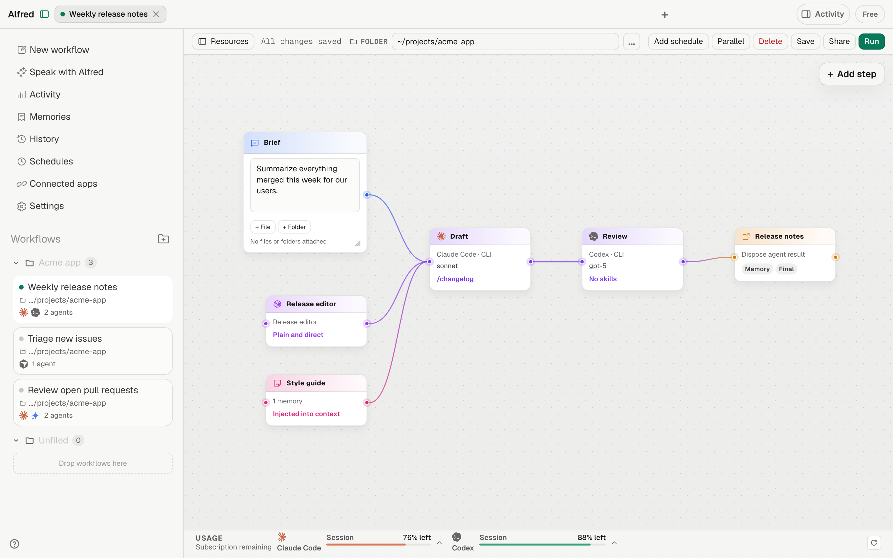
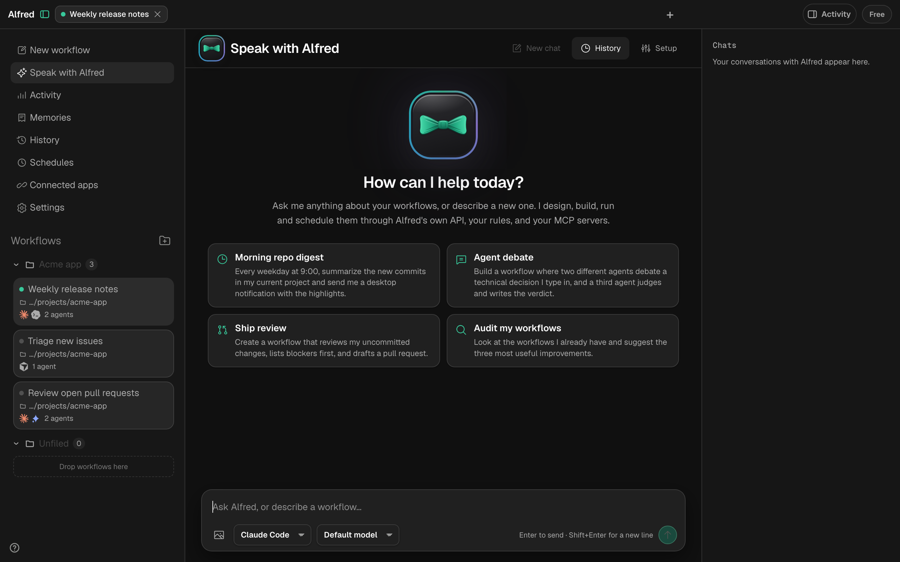
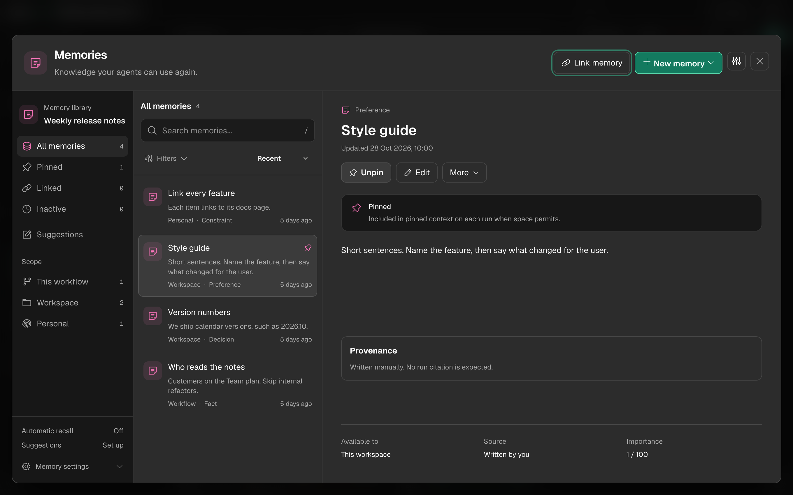
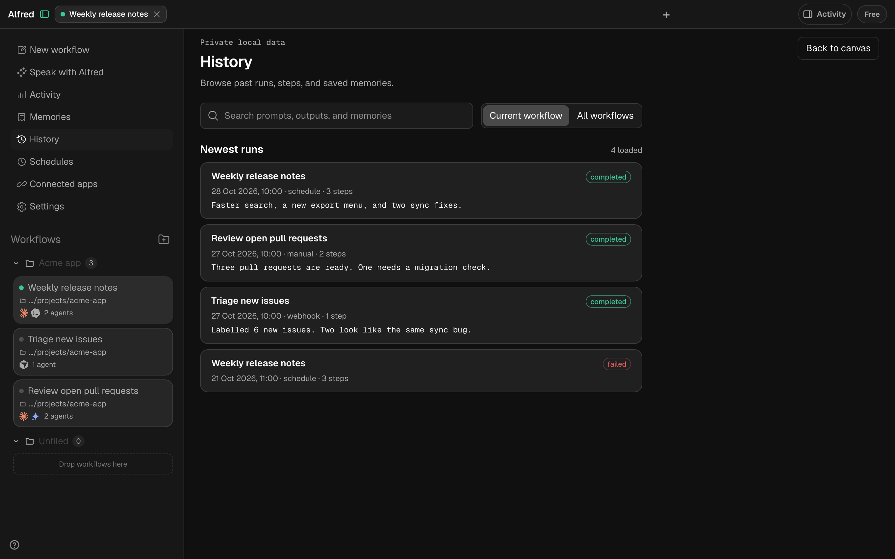

<p align="center">
  
</p>

<h1 align="center">Alfred</h1>

<p align="center">
  <strong>Automate your AI coding agents from one desktop app.</strong><br>
  Draw a workflow, choose which agent runs each step, and keep the results on your machine.
</p>

<p align="center">
  <a href="https://github.com/Nirzhuk/alfred/releases/latest">Download</a> ·
  <a href="docs/install.md">Install guide</a> ·
  <a href="docs/workflows-and-memory.md">How it works</a> ·
  <a href="CONTRIBUTING.md">Contribute</a>
</p>

<picture>
  <source media="(prefers-color-scheme: dark)" srcset="docs/images/canvas-dark.png">
  <source media="(prefers-color-scheme: light)" srcset="docs/images/canvas-light.png">
  
</picture>

> **Free and open source.** The complete source is available under
> [GPL-3.0-or-later](LICENSE). Official maintainer-built installers are
> published as public
> [GitHub Release assets](https://github.com/Nirzhuk/alfred/releases/latest)
> and are free for everyone. An optional one-time supporter licence exists (see
> [Support Alfred](#support-alfred)); nobody is ever required to pay.

| Get Alfred | Cost | What you get |
| --- | --- | --- |
| **Official builds** | **Free** | Maintainer-built, CI-tested installers from GitHub Releases. macOS builds are Developer ID signed, notarized, and stapled; the Windows installer is an unsigned beta |
| [Build from source](docs/building-from-source.md) | **Free** | A local build you compile yourself, with every feature |

Alfred updates itself from version 1.2.0 on. It checks at launch and from
**Help → Check for Updates…** (also in the tray/menu-bar menu), asks before
installing, then restarts. Installs older than 1.2.0, and 1.2.0 `.deb`/`.rpm`
installs, update manually once from the GitHub releases page. Your workflows, runs,
schedules, and memories are local and survive an upgrade.

Fees charged by Claude, Cursor, OpenAI, or other agent providers for their own
services are separate from Alfred in every case. See
[Open-source and distribution policy](docs/open-source.md) for details.

## What it does

- **Workflows as automations:** sequences of inputs → agent steps → outputs. Every workflow can be run manually; scheduling is an optional later trigger for the same automation.
- **Multi-agent:** Claude Code, Cursor, Codex, OpenCode, GitHub Copilot, Gemini, Grok, Pi, and OMP via local CLIs.
- **Skills:** pin a `SKILL.md` skill on an agent step (invoked as `/skill-name …`).
- **Models:** pick the model/alias each agent should use (`sonnet`, `gpt-5`, `provider/model`, etc.).
- **Triggers:** optional cron schedules, file watchers, and loopback webhooks.
- **Connected apps:** connect services such as Slack, GitHub, Linear, Sentry, Gmail, and Microsoft 365. Credentials stay in your operating system's credential store. See [Connected Apps](docs/connected-apps.md).
- **Local persistence:** workflows, runs, memories, and schedules in SQLite on disk.

### Describe a workflow instead of drawing it

**Speak with Alfred** is a chat that designs, builds, runs, and schedules
workflows for you, using Claude Code or Codex.



### Give agents context they can reuse

The **Memory library** keeps notes, preferences, decisions, lessons, and
constraints. Each one belongs to a workflow, a workspace, or all your workflows.



### See what every run did

**History** lists past runs with their trigger, steps, and result, and lets you
search prompts, outputs, and memories.



<sub>Screenshots show Alfred's real interface with demo data.</sub>

## Install

**User guide:** [docs/install.md](docs/install.md) — official installers,
source builds, OS requirements, and agent CLI setup.

Short version:

1. Download an official installer from
   [GitHub Releases](https://github.com/Nirzhuk/alfred/releases/latest)
   or [compile from source](docs/building-from-source.md) — both free, both
   fully featured.
2. Install and sign in to at least one agent CLI you plan to use:
   - Claude Code → `claude`
   - Cursor Agent → `cursor-agent` (or `agent`)
   - Codex → `codex`
   - OpenCode → `opencode`
   - GitHub Copilot → `copilot`
   - Gemini CLI → `gemini`
   - Grok Build → `grok`
   - Pi → `pi`
   - OMP → `omp`
3. Confirm the CLI works in a normal terminal, then open Alfred and run a workflow.

Alfred does **not** replace those subscriptions or store their API keys. The
first-class Provider CLI harness shells out to CLIs already authenticated on
your machine; the additive Alfred native harness has separate accounts and
currently reports native execution as unavailable. Alfred never silently falls
back between harnesses. See [Agent harnesses](docs/agent-harnesses.md).

Schedules, file triggers, and webhooks only run while the app is open (including tray / menu bar). A scheduled time that passes while Alfred is closed follows that schedule's own choice: catch up on open, skip the missed run, or ask you per schedule.

## Core ideas

| Concept | Meaning |
| --- | --- |
| Prompt node | The instruction text fed into the next step |
| Identity node | Role, personality, and standing instructions for connected downstream agents |
| Memories node | Select saved context for a workflow path, including linked memories from other workflows |
| Agent node | Which CLI runs, with optional model + skill |
| Choose output | Set execution-time save, pin, and final-result preferences for a result |
| Run | Manually enqueue/execute the automation |
| Schedule | Optional cron that fires the same runner while the app is open, plus what to do about a time missed while Alfred was closed |

The rules behind these (identity, memory settings, saving outputs, and lookup)
are in [How workflows and memory behave](docs/workflows-and-memory.md).

## Support Alfred

Official binaries and source builds are both completely free, and nobody is
ever required to pay for Alfred. If you want to support its development, a
one-time **Alfred Supporter** licence permanently unlocks two automation
perks — cron **schedules** and file-watch/webhook **triggers** — in official
builds. The licence never expires, and nothing you bought is ever taken away
later. A build you compile from source includes those features unlocked by
design, and manual workflow runs stay free in every build.

<!-- TODO: supporter checkout link (`VITE_POLAR_DESKTOP_CHECKOUT_URL`) once configured -->

## Platforms

Desktop only: **macOS 11+**, **Windows 10/11**, and **Linux**. Android, iOS, and standalone website builds are not supported.

Official binaries are published on the
[GitHub releases page](https://github.com/Nirzhuk/alfred/releases/latest):
one file per platform: `…_macOS-Apple-Silicon.dmg`, `…_macOS-Intel.dmg` (older
Macs), `…_Windows-setup.exe`, and `…_Linux.AppImage`. The Windows installer is an **unsigned beta**:
Windows reports an unknown publisher and may show a SmartScreen warning. See
[installing](docs/install.md), [building from source](docs/building-from-source.md),
and the [maintainer release runbook](docs/releasing.md).

## Develop

```bash
bun install
bun run dev        # Alfred Dev (Tauri + Vite)
bun run build      # production Alfred installers for the current OS
bun run build:dev  # optimized Alfred Dev installers for the current OS
bun run check    # frontend tests/build + Rust tests
```

Frontend Vite is started automatically by Tauri (`dev:frontend` / `build:frontend`). Do not use Vite alone as a website.

`bun run dev` automatically applies `src-tauri/tauri.dev.conf.json`.
Alfred Dev uses `com.nirzhuk.alfred.dev`, separate local data and Alfred-owned
credential namespaces, and starts without production workflows or connections.
Production keeps its existing identity, data paths, and credentials.
Restart any development command that was already running before this separation.

On macOS, Quick Access defaults to `Cmd+Alt+Shift+Space` in dev and
`Cmd+Shift+Space` in production. On other platforms, use `Ctrl` instead of `Cmd`.
The webhook listener defaults to port `8788` in dev and `8787` in production;
`ALFRED_HTTP_PORT` still overrides either. Dev does not register production
import-link schemes.

For a local macOS app bundle without a disk image, run
`bun run build:dev --bundles app`; the result is
`src-tauri/target/release/bundle/macos/Alfred Dev.app`.
These variants do not isolate external CLI accounts or workspace files.
Claude Code's managed subscription profile also shares the host Keychain.

To inspect startup timing, run `ALFRED_STARTUP_TRACE=1 bun run dev`. The terminal
reports native setup, window reveal, and background runtime verification times.
Bundled runtime checks run in the background; schedules and event triggers start
after those checks finish.

The complete platform prerequisites and expected artifact paths are in
[docs/building-from-source.md](docs/building-from-source.md).

### Stack

- **UI** — React + React Flow (`@xyflow/react`)
- **Shell** — Tauri 2
- **Data** — SQLite (`rusqlite`) in the Rust backend
- **Execution** — Rust agent adapters that spawn local CLIs

## Contributing

Issues and pull requests are welcome. Start with [CONTRIBUTING.md](CONTRIBUTING.md),
follow the [Code of Conduct](CODE_OF_CONDUCT.md), and report vulnerabilities as
described in [SECURITY.md](SECURITY.md).

Official binaries publish automatically when a `vX.Y.Z` tag is pushed; the
runbook is [docs/releasing.md](docs/releasing.md) and the current checklist is
[docs/release-todo.md](docs/release-todo.md).

## License

Alfred is free software licensed under
[GPL-3.0-or-later](LICENSE), Copyright © 2026 nirzhuk. You may use, modify,
compile, and redistribute it, including commercially, provided you follow the
GPL. Distributed binaries must be accompanied by access to their corresponding
source under the same license.

The GPL does not grant trademark rights or permission to imply that an
unofficial build is an official Alfred release. See
[BRANDING.md](BRANDING.md) and the
[open-source and distribution policy](docs/open-source.md).
